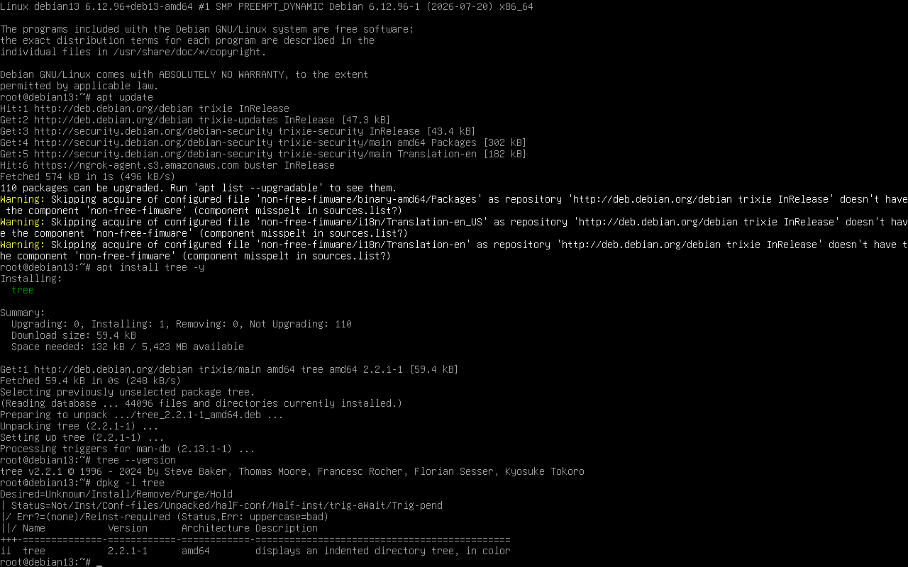
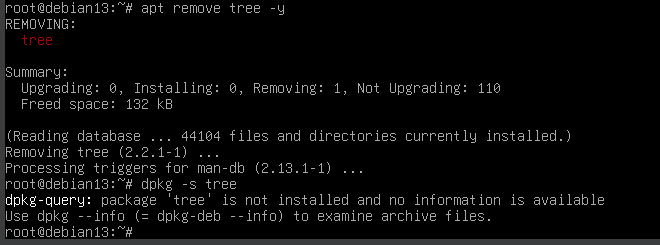

# Lab 01 — Software Management

Kembali ke [README project](../../README.md) atau lihat [capaian pembelajaran](../../docs/learning-outcome.md). Setelah praktik, isi [catatan praktik](evidence/catatan-praktik.md).

## Tujuan

Siswa mampu memeriksa informasi sistem Debian, memperbarui daftar paket, memasang software dari repositori resmi, memeriksa pemasangan, dan memahami cara menghapus paket uji dengan aman.

## Alat dan Bahan

- Komputer atau VM yang menjalankan Debian GNU/Linux 13.
- Koneksi internet dan repositori Debian yang dapat diakses.
- Akun pengguna dengan akses `sudo` sesuai izin pengajar.
- Terminal.

## Langkah Praktik

1. Periksa versi distribusi dan kernel:

   ```sh
   cat /etc/os-release
   uname -r
   ```

2. Perbarui indeks paket dari repositori yang sudah dikonfigurasi:

   ```sh
   sudo apt update
   ```

   Perintah ini mengambil informasi paket terbaru. Perintah ini tidak memasang pembaruan paket.

3. Periksa apakah paket contoh `tree` sudah tersedia:

   ```sh
   dpkg -l tree
   ```

   Jika sudah terpasang, catat kondisi tersebut. Jangan menghapus paket yang sudah digunakan sebelumnya. Jika belum terpasang, lanjutkan.

4. Pasang `tree` dari repositori resmi:

   ```sh
   sudo apt install tree
   ```

   Baca ringkasan perubahan yang ditampilkan APT sebelum menyetujui pemasangan.

5. Periksa status paket dan jalankan programnya:

   ```sh
   dpkg -l tree
   tree --version
   ```

6. Penghapusan bersifat opsional. Hanya jika `tree` dipasang khusus untuk lab ini dan pengajar menyetujui, periksa ringkasan lalu hapus paket:

   ```sh
   sudo apt remove tree
   ```

   Jika APT menyatakan paket lain yang diperlukan akan ikut dihapus, batalkan dan tanyakan kepada pengajar. Tidak perlu menghapus paket yang sudah ada sebelum praktik.

## Penjelasan Perintah

- `apt update`: menyegarkan indeks paket lokal berdasarkan repositori yang dikonfigurasi; bukan memperbarui semua software.
- `apt install nama-paket`: memasang paket dan dependensi yang diperlukan. Periksa rencana perubahan sebelum menyetujuinya.
- `apt remove nama-paket`: menghapus paket, tetapi biasanya membiarkan berkas konfigurasi paket.
- `dpkg -l`: menampilkan informasi dan status paket yang diketahui sistem. Status `ii` umumnya menunjukkan paket telah terpasang.
- `cat /etc/os-release` dan `uname -r`: menampilkan identitas distribusi serta versi kernel.

## Hasil Praktik yang Terlihat

Screenshot menunjukkan perintah dijalankan dari shell root pada Debian 13 (trixie). `apt update` mengambil 574 kB indeks paket dan melaporkan 110 paket dapat ditingkatkan. Proses selesai, tetapi ada peringatan bahwa komponen `non-free-firmware` tidak ditemukan pada konfigurasi repositori; peringatan ini perlu ditinjau jika pembaruan indeks berikutnya diperlukan.

`apt install tree -y` memasang satu paket, versi `2.2.1-1` untuk `amd64`. `tree --version` menampilkan versi 2.2.1 dan `dpkg -l tree` menunjukkan status `ii` (terpasang). Selanjutnya `apt remove tree -y` menghapus paket dan membebaskan 132 kB. Pemeriksaan `dpkg -s tree` menyatakan paket tidak terpasang. APT tidak meningkatkan 110 paket yang tersedia.

## Bukti Screenshot





## Keselamatan

Jangan menjalankan `apt upgrade`, `apt autoremove`, atau menghapus paket lain sebagai bagian latihan ini. Tinjau daftar perubahan APT, dan batalkan jika ada hal yang tidak dipahami.

## Kesimpulan

Pada praktik ini indeks paket diperbarui, `tree` dipasang dan diverifikasi, lalu dihapus dan diperiksa kembali. `apt update` memperbarui informasi paket, bukan seluruh paket sistem. APT juga memberi peringatan repositori tentang `non-free-firmware`; paket lain tidak ditingkatkan dalam praktik yang terekam.
