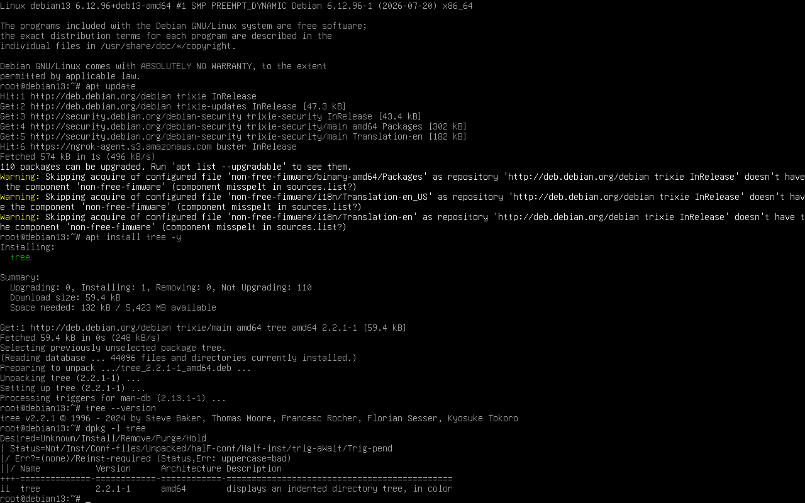
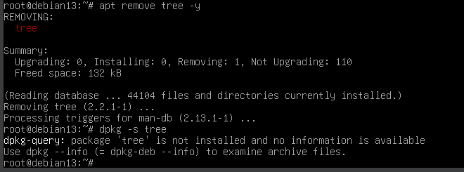

# Catatan Praktik — Lab 01 Software Management

**Nama:** ______________________________  
**Kelas:** ______________________________  
**Tanggal pada bukti:** 13 November 2026  
**Perangkat/VM:** Debian 13 (trixie), shell root  
**Nama file screenshot:** `01-software-installation.png`, `02-software-removal.png`





> Bagian perintah dan output berikut ditranskripsikan dari screenshot, bukan salinan lengkap terminal.

## Perintah Asli yang Terlihat

```text
apt update
apt install tree -y
tree --version
dpkg -l tree
apt remove tree -y
dpkg -s tree
```

## Output Asli yang Terlihat

```text
Fetched 574 kB in 1s (496 kB/s)
110 packages can be upgraded.
Warning: Skipping acquire of configured file for component 'non-free-firmware'
tree v2.2.1
ii tree 2.2.1-1 amd64
Freed space: 132 kB
dpkg-query: package 'tree' is not installed
```

## Refleksi Setelah Praktik

`tree` versi `2.2.1-1` terlihat terpasang dengan status `ii`, lalu dihapus dan dikonfirmasi tidak terpasang. `apt update` menampilkan peringatan komponen `non-free-firmware`; 110 paket dapat ditingkatkan dan tidak di-upgrade pada praktik ini.
   
