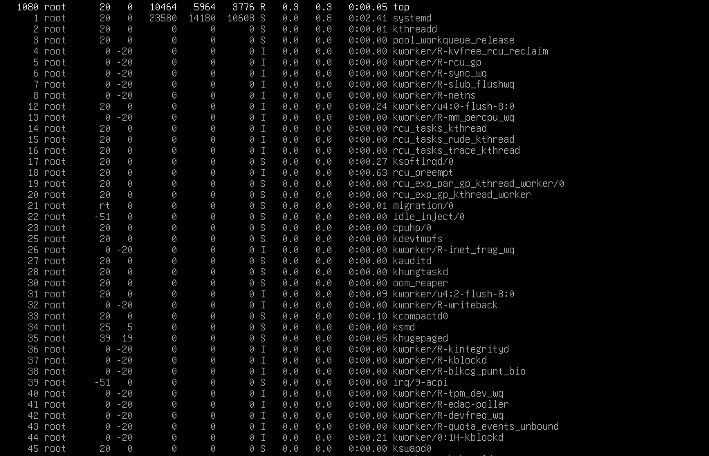
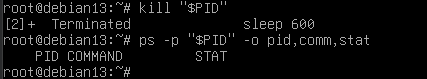

# Lab 02 — Process Management

Kembali ke [README project](../../README.md) atau lihat [capaian pembelajaran](../../docs/learning-outcome.md). Setelah praktik, isi [catatan praktik](evidence/catatan-praktik.md).

## Tujuan

Siswa mampu melihat proses Linux, mengenali PID, memantau proses secara interaktif, membuat proses uji `sleep`, dan menghentikan hanya proses uji yang dibuat sendiri.

## Alat dan Bahan

- Komputer atau VM Debian GNU/Linux 13.
- Terminal.
- Akun pengguna biasa. `sudo` tidak diperlukan untuk proses uji ini.

## Langkah Praktik

1. Tampilkan daftar proses:

   ```sh
   ps aux
   ```

2. Pantau proses secara langsung:

   ```sh
   top
   ```

   Tekan `q` untuk keluar dari `top`.

3. Buat proses uji selama 10 menit di terminal yang sama, lalu simpan PID-nya:

   ```sh
   sleep 600 &
   TEST_PID=$!
   printf 'PID proses uji: %s\n' "$TEST_PID"
   ```

   Variabel `TEST_PID` berlaku di sesi shell tersebut. Jangan tutup sesi sebelum proses uji dihentikan.

4. Pastikan PID tersebut memang menjalankan `sleep` yang Anda buat:

   ```sh
   ps -p "$TEST_PID" -o pid,comm,args
   ```

5. Setelah memastikan nama dan perintahnya cocok dengan proses uji, hentikan proses itu saja:

   ```sh
   kill "$TEST_PID"
   ```

6. Periksa bahwa proses uji sudah tidak tampil:

   ```sh
   ps -p "$TEST_PID" -o pid,comm,args
   ```

   Jika variabel PID tidak tersedia atau informasi proses tidak cocok, jangan jalankan `kill`; identifikasi kembali proses uji bersama pengajar. Tunggu hingga proses `sleep 600` berakhir sendiri juga merupakan pilihan yang aman.

## Penjelasan Perintah dan Istilah

- **PID (Process ID):** nomor yang digunakan sistem untuk membedakan proses yang sedang berjalan.
- `ps aux`: menampilkan daftar proses beserta pemilik, penggunaan sumber daya, dan perintahnya.
- `top`: menampilkan proses dan penggunaan sumber daya secara dinamis; `q` menutup tampilan.
- `sleep 600`: proses uji yang menunggu selama 600 detik.
- `kill PID`: mengirim sinyal ke proses dengan PID tersebut. Tanpa opsi sinyal, perintah ini meminta proses berhenti secara normal; pastikan PID benar.
- `nice`: menjalankan proses dengan nilai niceness tertentu agar prioritas penjadwalannya lebih rendah atau lebih tinggi secara relatif. Jangan mengubah prioritas proses sistem untuk latihan ini.

## Hasil Praktik yang Terlihat

Screenshot pemantauan menampilkan tabel proses Linux dalam `top`, termasuk kolom PID, pemilik, status, penggunaan sumber daya, dan nama perintah. Screenshot kontrol memperlihatkan `kill "$PID"`; shell melaporkan `[2]+ Terminated sleep 600`. Sesudah itu, `ps -p "$PID" -o pid,comm,stat` hanya menampilkan judul kolom `PID COMMAND STAT`, sehingga proses tersebut tidak lagi tercantum.

Nilai angka PID dan langkah yang membuat `sleep 600` tidak terlihat pada screenshot. Karena itu catatan ini tidak menetapkan PID tertentu atau mengklaim bahwa angka PID dapat diverifikasi dari bukti. Screenshot pemantauan juga tidak memperlihatkan pemanggilan `ps aux`.

## Bukti Screenshot





## Keselamatan

Jangan menghentikan proses sistem, proses pengguna lain, atau proses yang namanya/PID-nya belum dipastikan. Jangan menyalin PID dari contoh atau dari siswa lain. Praktik ini tidak memerlukan `sudo`.

## Kesimpulan

PID adalah identitas numerik proses dan harus diperiksa sebelum dipakai sebagai sasaran `kill`. `top` menampilkan tabel proses secara dinamis; `ps` dapat menampilkan daftar atau memeriksa PID tertentu. Pada bukti ini, proses `sleep 600` dilaporkan berhenti dan tidak muncul lagi pada pemeriksaan `ps`, tetapi angka PID tidak tercatat.
