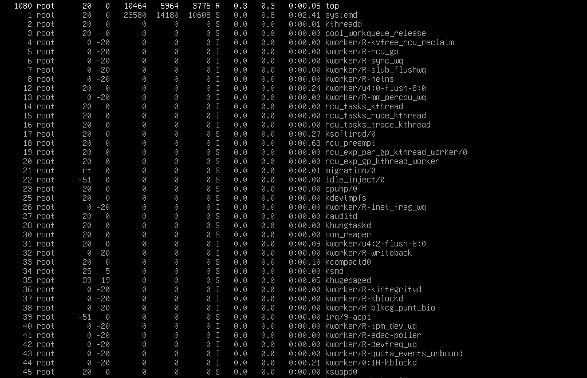
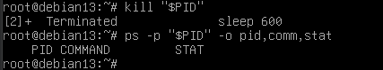

# Catatan Praktik — Lab 02 Process Management

**Nama:** ______________________________  
**Kelas:** ______________________________  
**Tanggal pada bukti:** 13 November 2026  
**Perangkat/VM:** Debian 13  
**Nama file screenshot:** `03-process-monitoring.png`, `04-process-control.png`





> Transkripsi ringkas dari screenshot. Nilai angka PID dan langkah pembuatan `sleep` tidak terlihat, jadi tidak diisi dengan perkiraan.

## Perintah Asli yang Terlihat

```text
Tampilan tabel proses top (perintah pemanggilannya tidak tampak)
kill "$PID"
ps -p "$PID" -o pid,comm,stat
```

## Output Asli yang Terlihat

```text
[2]+ Terminated sleep 600
PID COMMAND STAT
```

## Refleksi Setelah Praktik

Screenshot kontrol menunjukkan `sleep 600` terminated dan pemeriksaan `ps` tidak menampilkan proses selain header. Angka PID serta pemanggilan `ps aux` tidak terlihat, sehingga keduanya tidak dapat dikonfirmasi dari bukti ini.
   
