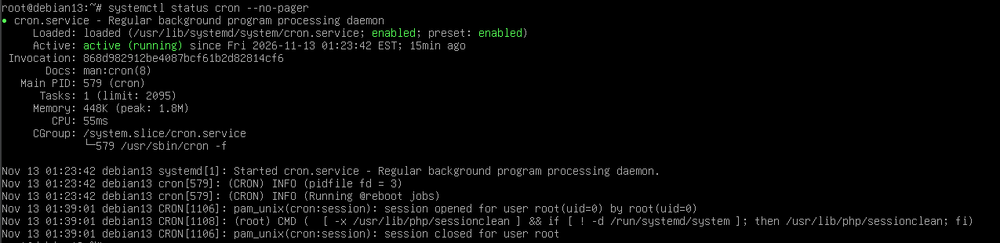
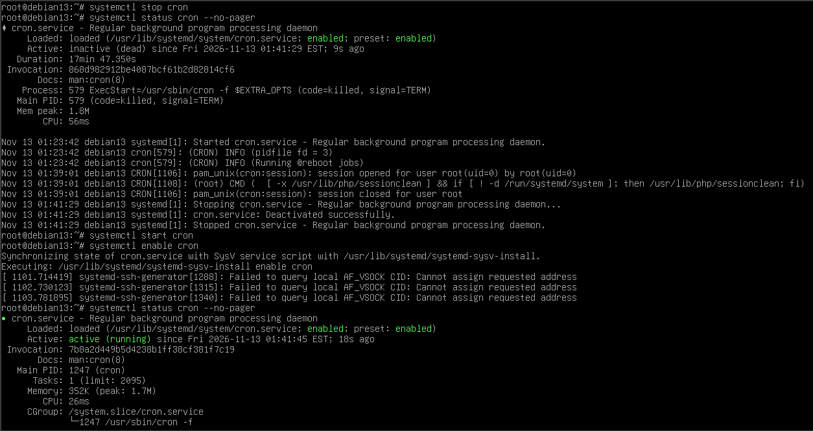

# Lab 03 — Service Management

Kembali ke [README project](../../README.md) atau lihat [capaian pembelajaran](../../docs/learning-outcome.md). Setelah praktik, isi [catatan praktik](evidence/catatan-praktik.md).

## Tujuan

Siswa mampu memeriksa status layanan dengan `systemctl`, memulai dan menghentikan layanan, mengaktifkan layanan agar berjalan saat boot, serta memeriksa status setelah perubahan.

## Alat dan Bahan

- Debian GNU/Linux 13 di VM atau mesin latihan yang mendapat izin pengajar.
- Terminal dan akun dengan akses `sudo`.
- Layanan `cron` terpasang. Jika tidak ada, minta bantuan pengajar; jangan memasang atau mengubah layanan lain tanpa izin.

## Peringatan Keselamatan

`cron` dapat menjalankan tugas terjadwal milik sistem dan pengguna lain. Lakukan praktik stop/start hanya pada VM khusus atau mesin latihan yang dipastikan tidak menjalankan pekerjaan penting. Jangan menghentikan layanan pada komputer bersama, server, atau sistem yang sedang digunakan untuk koneksi aktif. Jangan gunakan langkah ini pada layanan jaringan, SSH, atau layanan penting lain.

## Langkah Praktik

1. Periksa status layanan sebelum perubahan:

   ```sh
   systemctl status cron --no-pager
   ```

   Jika layanan tidak ditemukan, berhenti dan minta arahan pengajar.

2. Mulai layanan jika pengajar mengizinkan:

   ```sh
   sudo systemctl start cron
   systemctl is-active cron
   ```

3. Aktifkan agar layanan dijalankan saat boot, lalu periksa status enable:

   ```sh
   sudo systemctl enable cron
   systemctl is-enabled cron
   ```

4. Pada VM khusus saja, dan jika pengajar mengizinkan, praktikkan penghentian lalu segera mulai kembali:

   ```sh
   sudo systemctl stop cron
   systemctl is-active cron
   sudo systemctl start cron
   systemctl is-active cron
   ```

5. Periksa status akhir:

   ```sh
   systemctl status cron --no-pager
   systemctl is-enabled cron
   ```

Jika suatu langkah ditolak atau kondisi awal berbeda, jangan memaksa perubahan. Catat keadaan sebenarnya dan minta arahan pengajar.

## Penjelasan Perintah

- `systemctl status nama-layanan`: menampilkan kondisi layanan dan informasi ringkas terkait.
- `systemctl start nama-layanan`: memulai layanan sekarang.
- `systemctl stop nama-layanan`: menghentikan layanan sekarang. Dampaknya harus dipahami sebelum dijalankan.
- `systemctl enable nama-layanan`: mengatur layanan agar dimulai otomatis saat boot; perintah ini tidak selalu memulai layanan saat itu juga.
- `systemctl is-active nama-layanan`: memeriksa apakah layanan sedang aktif.
- `systemctl is-enabled nama-layanan`: memeriksa apakah layanan diatur untuk mulai saat boot.
- `sudo`: menjalankan perintah dengan hak administratif setelah otorisasi pengguna.

## Hasil Praktik yang Terlihat

Pada screenshot status awal, `systemctl status cron --no-pager` menunjukkan unit loaded, `enabled`, dan `active (running)` dengan Main PID 579. Screenshot kontrol memperlihatkan `systemctl stop cron`, lalu status `inactive (dead)`. Setelah `systemctl start cron` dan `systemctl enable cron`, status akhir kembali `active (running)` serta `enabled`, dengan Main PID 1247.

Saat proses `enable`, output juga menampilkan beberapa pesan `systemd-ssh-generator` yang gagal mendapatkan local AF_VSOCK CID (`Cannot assign requested address`). Meskipun pesan tersebut muncul, screenshot berikutnya tetap menunjukkan `cron` aktif dan enabled; bukti tidak mengaitkan pesan itu dengan kegagalan layanan cron.

## Bukti Screenshot





## Kesimpulan

Praktik merekam bahwa `stop` membuat `cron` berstatus inactive, sedangkan `start` menjalankannya kembali. `enable` mengatur layanan agar dimulai saat boot; status akhir screenshot menunjukkan layanan aktif sekaligus enabled. Penghentian layanan berdampak pada tugas terjadwal, sehingga praktik semacam ini hanya dilakukan pada lingkungan latihan yang disetujui.
