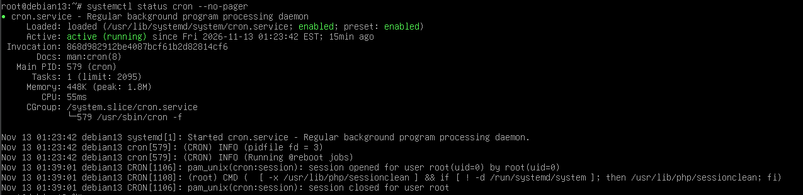
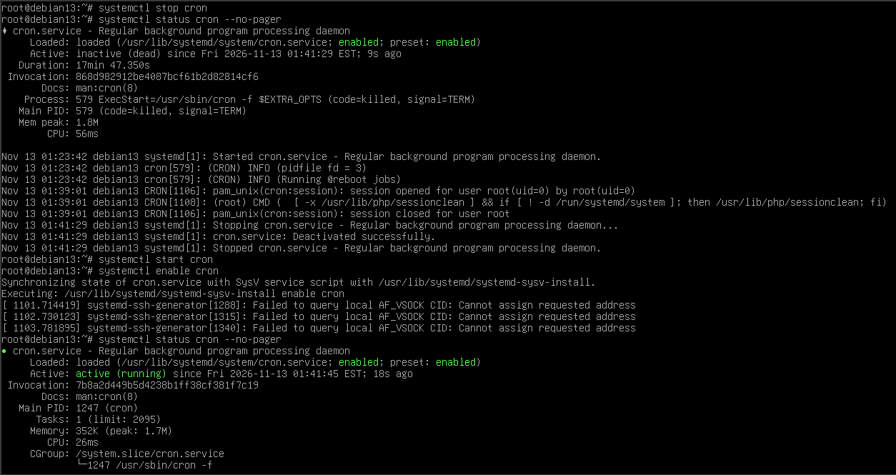

# Catatan Praktik — Lab 03 Service Management

**Nama:** ______________________________  
**Kelas:** ______________________________  
**Tanggal pada bukti:** 13 November 2026  
**Perangkat/VM:** Debian 13, shell root  
**Nama file screenshot:** `05-service-status.png`, `06-service-control.png`





> Transkripsi ringkas bagian status dan pesan yang terbaca pada screenshot.

## Perintah Asli yang Terlihat

```text
systemctl status cron --no-pager
systemctl stop cron
systemctl status cron --no-pager
systemctl start cron
systemctl enable cron
systemctl status cron --no-pager
```

## Output Asli yang Terlihat

```text
Sebelum: Loaded: enabled; Active: active (running); Main PID: 579 (cron)
Setelah stop: Active: inactive (dead)
Status akhir: Loaded: enabled; Active: active (running); Main PID: 1247 (cron)
Pesan saat enable: Failed to query local AF_VSOCK CID: Cannot assign requested address
```

## Refleksi Setelah Praktik

`cron` awalnya aktif dan enabled, menjadi inactive setelah `stop`, lalu kembali aktif dan enabled setelah `start`/`enable`. Pesan AF_VSOCK muncul saat enable; status akhir cron tetap aktif pada screenshot.
   
