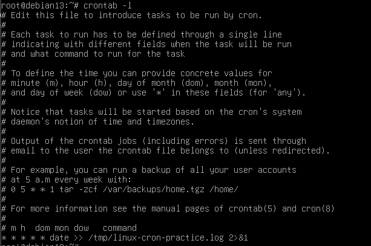
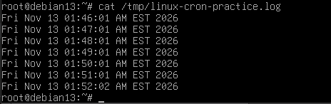

# Lab 04 — Task Scheduling

Kembali ke [README project](../../README.md) | [Capaian pembelajaran](../../docs/learning-outcome.md) | [Catatan praktik](evidence/catatan-praktik.md)

## Tujuan

Memahami format jadwal cron, membaca crontab, dan memeriksa bukti tugas terjadwal yang menulis waktu ke file log.

## Alat dan Bahan

- Debian GNU/Linux 13 dengan layanan `cron` berjalan.
- Terminal dan akses ke crontab yang dipraktikkan.
- Screenshot menunjukkan sesi shell `root@debian13`; crontab yang terlihat adalah crontab root, bukan crontab user biasa.

## Langkah Praktik

Kembali ke [README project](../../README.md) | [Capaian pembelajaran](../../docs/learning-outcome.md) | [Catatan praktik](evidence/catatan-praktik.md)

1. `crontab -l` menampilkan crontab saat ini, termasuk tugas berikut:
   ```sh
Memahami format jadwal cron, membaca crontab, dan memeriksa catatan waktu yang dibuat oleh tugas terjadwal.
   ```

   Jika tidak aktif atau layanan tidak ditemukan, minta arahan pengajar. Jangan mengubah layanan sendiri jika tidak berwenang.

- Terminal.
- Screenshot menunjukkan sesi `root@debian13`, sehingga crontab yang diperiksa adalah milik root.
   ```
## Langkah Praktik
3. `cat /tmp/linux-cron-practice.log` menampilkan tujuh baris waktu berurutan yang tercatat setiap menit.
1. `crontab -l` menampilkan crontab milik root. Screenshot memperlihatkan baris tugas berikut:
   ```
   ```cron
   * * * * * date >> /tmp/linux-cron-practice.log 2>&1
   ```

2. `cat /tmp/linux-cron-practice.log` menampilkan waktu yang telah ditulis oleh tugas.
3. Screenshot tidak menunjukkan perintah yang membuat atau mengedit crontab, maupun penghapusan tugas setelah pengujian. Karena itu dokumentasi tidak menyatakan bagaimana baris ditambahkan atau apakah sudah dibersihkan.

## Penjelasan Perintah dan Format Jadwal

- `crontab -l` menampilkan crontab user yang menjalankan perintah. Dalam bukti ini prompt menunjukkan `root`.
- Lima kolom jadwal adalah menit, jam, tanggal dalam bulan, bulan, dan hari dalam minggu. `* * * * *` berarti tugas dijadwalkan setiap menit.
- `date` menampilkan waktu saat tugas berjalan.
- `>>` menambahkan keluaran ke akhir file tanpa menimpa isi sebelumnya.
- `2>&1` mengarahkan keluaran error ke tujuan keluaran biasa.
- `cat /tmp/linux-cron-practice.log` membaca dan menampilkan isi log.
- `crontab -e` mengedit jadwal user saat ini. Jika mengulang praktik, hapus hanya baris latihan dan jangan gunakan `crontab -r`.

## Hasil Praktik

Log menunjukkan tujuh waktu berurutan pada 13 November 2026, zona EST: 01:46:01, 01:47:01, 01:48:01, 01:49:01, 01:50:01, 01:51:01, dan 01:52:01. Ini sesuai dengan tugas yang dijadwalkan setiap menit. Screenshot tidak menunjukkan bagaimana baris ditambahkan atau apakah tugas kemudian dihapus, jadi cleanup belum dapat dipastikan.

## Bukti Screenshot





## Keselamatan

Praktik pada bukti memakai crontab root dan menulis ke `/tmp`. Untuk latihan berikutnya, gunakan crontab user biasa dan file log di home agar hak akses lebih terbatas. Setelah selesai, hapus hanya baris latihan dan pertahankan entri lain. Bukti yang tersedia belum menunjukkan bahwa pembersihan dilakukan.

## Kesimpulan

Lima kolom `* * * * *` menjadwalkan tugas setiap menit, dan tujuh baris waktu pada log menunjukkan eksekusi berulang pada rentang yang terlihat. Belum ada bukti bahwa baris latihan dihapus setelah pengujian.
1. `* * * * *` menjadwalkan perintah setiap menit. Perintah yang tercatat adalah `date` dengan output ditambahkan ke file log.
