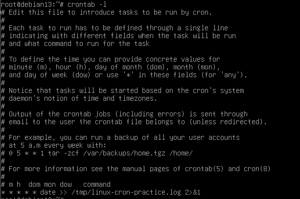
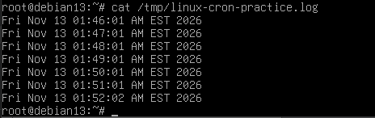

# Catatan Praktik — Lab 04 Task Scheduling

**Nama:** ______________________________  
**Kelas:** ______________________________  
**Tanggal pada bukti:** 13 November 2026  
**Perangkat/VM:** Debian 13, crontab root  
**Nama file screenshot:** `07-cron-configuration.png`, `08-cron-result.png`





> Transkripsi ringkas dari screenshot. Gambar menunjukkan crontab root; proses penambahan atau penghapusan baris tidak terlihat.

## Perintah Asli yang Terlihat

```text
crontab -l
cat /tmp/linux-cron-practice.log
```

## Output Asli yang Terlihat

```text
* * * * * date >> /tmp/linux-cron-practice.log 2>&1
Fri Nov 13 01:46:01 AM EST 2026
Fri Nov 13 01:47:01 AM EST 2026
Fri Nov 13 01:48:01 AM EST 2026
Fri Nov 13 01:49:01 AM EST 2026
Fri Nov 13 01:50:01 AM EST 2026
Fri Nov 13 01:51:01 AM EST 2026
Fri Nov 13 01:52:01 AM EST 2026
```

## Refleksi Setelah Praktik

`* * * * *` berarti tugas dijadwalkan setiap menit. Log menunjukkan tujuh waktu berurutan dari 01:46:01 sampai 01:52:01 EST. Bukti tidak menunjukkan penghapusan baris latihan; status cleanup belum terverifikasi.
   
